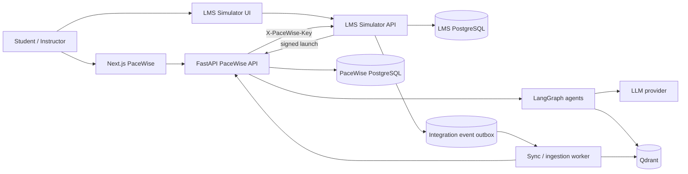
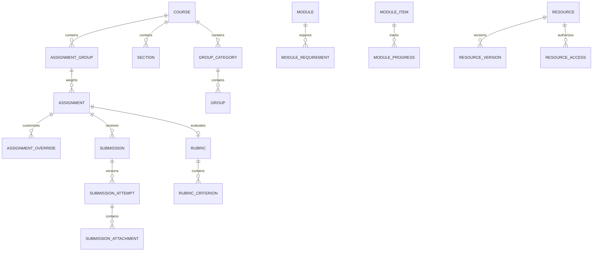
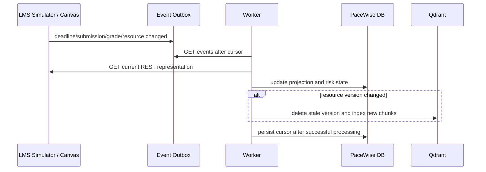

# PaceWise Architecture

## Tổng quan

PaceWise gồm web app cho sinh viên/giảng viên, FastAPI backend điều phối workflow
AI, PostgreSQL lưu trạng thái học tập, Qdrant lưu vector và LMS Simulator mô phỏng
contract Canvas. LMS là nguồn cho course, deadline, submission, rubric, module
progress và learning evidence; frontend không tự tính lại các dữ liệu này.



## Các service

| Service | Trách nhiệm | Port |
|---|---|---:|
| `frontend` | UI PaceWise; chỉ render dữ liệu/backend decisions | 3000 |
| `backend` | Auth, planning scheduler, AI workflow, RAG, calendar | 8000 |
| `worker` | LMS event projection, ingestion/versioning và tác vụ nền | — |
| `pacewise-postgres` | Plan, reflection, memory/checkpoint, audit | nội bộ |
| `qdrant` | Vector index theo tenant/course/resource/version/scope | 6333 |
| `lms-simulator` | Canvas-compatible UI/API và signed launch | 8010 |
| `lms-postgres` | Course và learning records nguồn | nội bộ |

## LMS domain phục vụ PaceWise



Deadline hiệu lực được backend giải theo thứ tự:

```text
student override > group override > section override > assignment default
```

Assignment group, module rule, rubric và resource metadata là dữ liệu có cấu
trúc. PaceWise không đọc HTML giao diện để suy diễn các khái niệm này.

## Luồng đồng bộ và RAG



REST là nguồn trạng thái hiện tại; event chỉ kích hoạt đồng bộ. Chat request chỉ
retrieval, không ingest tài liệu trong request path. Vector metadata phải gồm
`institution_id`, `course_id`, `resource_id`, `resource_version` và
`access_scope`.

## Bảo mật

- LMS UI dùng opaque server session; cookie `HttpOnly`, `SameSite=Lax` và CSRF
  cho thao tác ghi.
- Middleware buộc mọi actor ID cũ phải khớp user trong session.
- PaceWise gọi LMS bằng service key; launch token ký HMAC, có TTL và nonce một lần.
- Mọi API course kiểm tra enrollment và role; tài liệu kiểm tra access scope.
- Secret chỉ lấy từ environment/secret manager, không commit `.env`.
- Production bật HTTPS, secure cookie, rate limit và centralized session revocation.

## Quy tắc thiết kế

1. Backend là nguồn duy nhất tạo milestone và schedule; frontend chỉ hiển thị.
2. Agent memory có key `institution:user:course:learning-cycle`.
3. LLM không trực tiếp ghi dữ liệu rủi ro; thao tác ghi cần deterministic
   validation và human confirmation.
4. Guardrail gồm rule nhanh, classifier hiệu chuẩn và output policy.
5. Mỗi thay đổi LMS phát audit log và integration event để có thể debug/replay.
