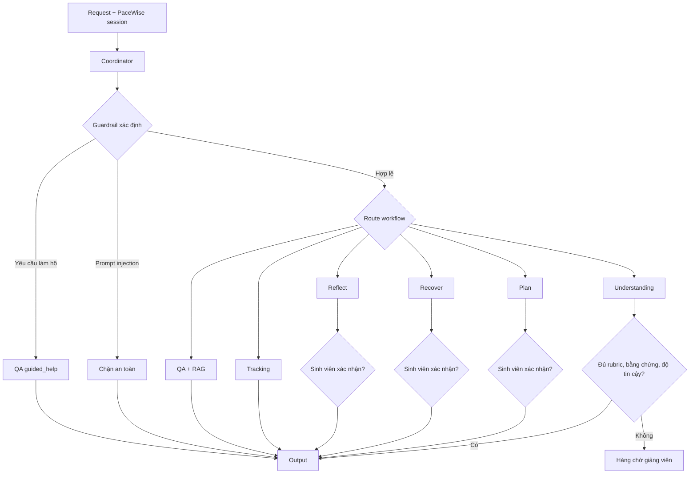

# PaceWise — AI workflows, kiểm thử và đánh giá

**Phiên bản:** `2026-09-28.v1`  
**Phạm vi:** Coordinator và sáu workflow Plan, Tracking, QA, Understanding, Recover, Reflect.

## 1. Luồng chạy chuẩn



Coordinator chạy lớp guardrail xác định trước khi gọi model. Khi intent rõ, bộ định tuyến xác định được ưu tiên để giảm latency và tránh phụ thuộc cách diễn đạt của LLM. Mỗi node ghi audit event chỉ gồm tên node, workflow, kết quả, latency và thời gian; không ghi prompt thô.

## 2. Hợp đồng của từng workflow

| Workflow | Input chính | Validator bắt buộc | Output/HITL |
|---|---|---|---|
| Plan | assignment, availability, unavailable slot | thời lượng, capacity, ID, dependency, cycle | bản nháp; chỉ áp dụng sau xác nhận |
| Tracking | deadline, estimated hours, current time | phép tính slack và overlap theo ngày/timezone | risk signal; đề nghị Recover nếu có nguy cơ |
| QA | query, course_id, tài liệu môn | course filter, retrieval score, citation khớp passage | trả lời có nguồn; từ chối khi thiếu nguồn |
| Understanding | câu trả lời, rubric đã duyệt | trạng thái, evidence, confidence, rubric | kết quả hỗ trợ; ca không chắc vào hàng chờ giảng viên |
| Recover | plan hiện tại, milestone, assignment | ít nhất hai phương án, đủ schema, bảo vệ deadline | snapshot + phương án; chưa sửa lịch trước xác nhận |
| Reflect | progress metrics, lịch sử tuần | draft có điều hiệu quả, nguyên nhân, một điều chỉnh, evidence | điều chỉnh tuần sau; chỉ áp dụng sau xác nhận |

API dùng PaceWise session trong cookie `HttpOnly` và bắt buộc CSRF cho request ghi dữ liệu. Backend tự lấy `user_id`, vai trò, môn đang chọn và `thread_id` từ session phía server; client không được tự chọn danh tính hoặc phạm vi course. Trước khi chạy graph, backend kiểm tra enrollment rồi nạp assignment, submission và tài liệu đúng môn từ LMS. Lỗi nội bộ không được trả nguyên văn cho client.

## 3. Test tự động

Chạy toàn bộ test và lint:

```powershell
python -m ruff check src/ evals/ tests/
python -m pytest tests/ -q
```

Test bao phủ routing, guardrail, prompt injection, yêu cầu làm hộ, RAG theo course, citation, plan constraint, overlap/timezone, HITL, rubric, assessment escalation, recovery, reflection, xác thực PaceWise, phân quyền course và API. CI yêu cầu line coverage của `src.agents` tối thiểu 80%.

Lần chạy local ngày 28/09/2026 đạt **116 test backend/agent pass** và **4 test LMS simulator pass**. CI dùng `pytest-cov` làm cổng chính thức và sẽ fail nếu line coverage của `src.agents` dưới 80%.

CI dùng `requirements-ci.txt` để không tải Qdrant/FastEmbed/Chroma trong unit test. Adapter vector được kiểm thử bằng fake module; kiểm thử tích hợp Qdrant thật phải chạy ở job/service riêng.

## 4. Eval định lượng

Chạy:

```powershell
python -m evals.run_agent_eval
python -m evals.run_agent_eval --output evals/reports/latest.json
```

Ba dataset chính đều có 120 mẫu; routing có thêm 120 mẫu hỗ trợ. Kết quả baseline đã lưu tại `evals/reports/deterministic-2026-09-28.json`.

| Metric | Ngưỡng P0 | Baseline xác định |
|---|---:|---:|
| Plan đúng ràng buộc | ≥95% | 100% |
| Recover bảo vệ deadline | ≥90% | 100% |
| Risk recall | ≥85% | 100% |
| Risk precision | ≥75% | 100% |
| Quyết định citation hợp lệ | ≥95% | 100% |
| Integrity recall | ≥95% | 100% |
| Chặn nhầm yêu cầu hợp lệ | ≤10% | 0% |
| Diagnosis macro-F1 | ≥0,80 | 1,00 |
| Lỗi diagnosis độ tin cậy cao | ≤5% | 0% |
| Routing accuracy | theo dõi | 100% |

### RAGAS trên dữ liệu pilot

`evals/run_ragas_eval.py` nhận JSONL tối thiểu 100 mẫu có bốn trường
`user_input`, `response`, `retrieved_contexts`, `reference`, sau đó tính
faithfulness, answer relevancy, context precision và context recall. Đây là eval tùy chọn cần
credential của model judge; không chạy trong CI xác định và không được báo cáo là đã đạt khi chưa
có dataset pilot được SME gán nhãn.

```powershell
pip install -r requirements-eval.txt
python evals/run_ragas_eval.py evals/datasets/rag-pilot.jsonl
```

### Load test và quan sát hệ thống

```powershell
pip install -r requirements-load.txt
locust -f load_tests/locustfile.py --host http://localhost:5173 --headless -u 1000 -r 50 -t 5m --csv evals/reports/load-1000
docker compose --profile observability up -d
```

Backend xuất request ID, structured log và Prometheus metrics cho HTTP, agent node và RAG.
Prometheus scrape `/metrics`; Grafana tự provision dashboard `PaceWise Overview`. Kịch bản 1.000
virtual users chỉ là acceptance profile: phải chạy trên staging đủ tài nguyên và lưu report trước
khi tuyên bố đạt tải.

## 5. Cách hiểu đúng kết quả

Kết quả 100% chỉ chứng minh các rule/validator hiện tại vượt bộ fixture tổng hợp đã version hóa; không chứng minh model đạt 100% ngoài đời. Không dùng test set để sửa prompt.

Trước production pilot vẫn bắt buộc:

- SME duyệt nhãn `understanding_journey_v1`, hai người gán nhãn độc lập và báo cáo độ đồng thuận.
- Chạy RAGAS/faithfulness với tài liệu pilot thật và hiệu chuẩn LLM-as-Judge bằng nhãn người.
- Test Qdrant thật, Postgres checkpointer, timeout/retry và model provider thật.
- Chạy load test 100 virtual users; chỉ tuyên bố 1.000 concurrent khi có bằng chứng.
- Security review cho rate limit, secret manager, quyền course/role và retention dữ liệu.

Vì vậy trạng thái hiện tại là **deterministic AI harness đã qua unit/eval**, chưa phải bằng chứng đủ để tuyên bố production-ready.
