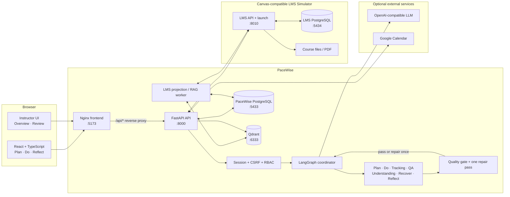
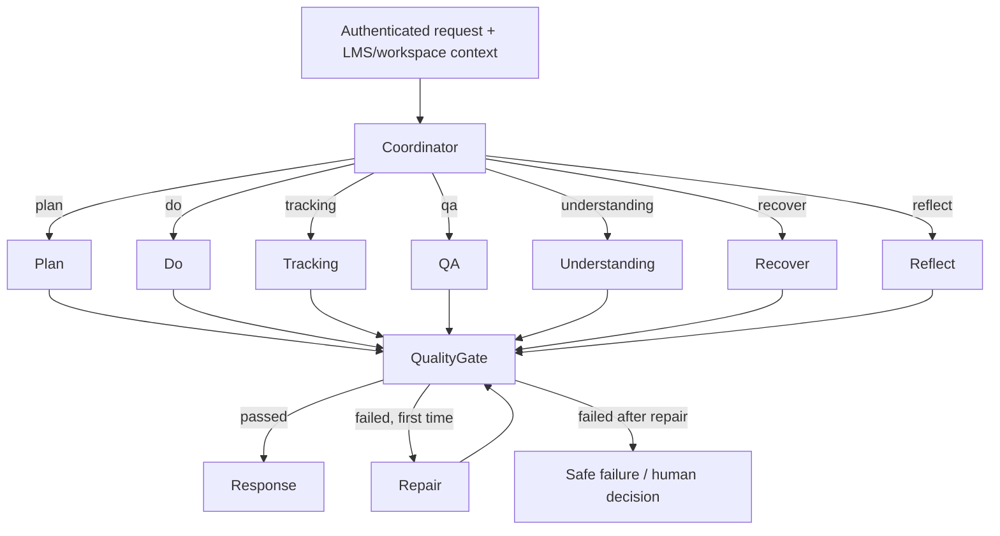
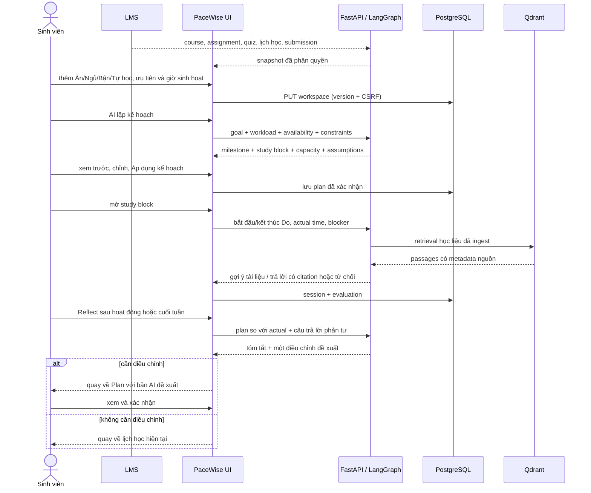
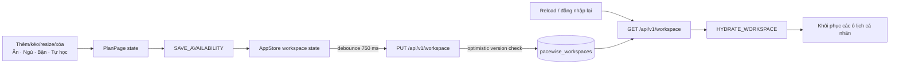
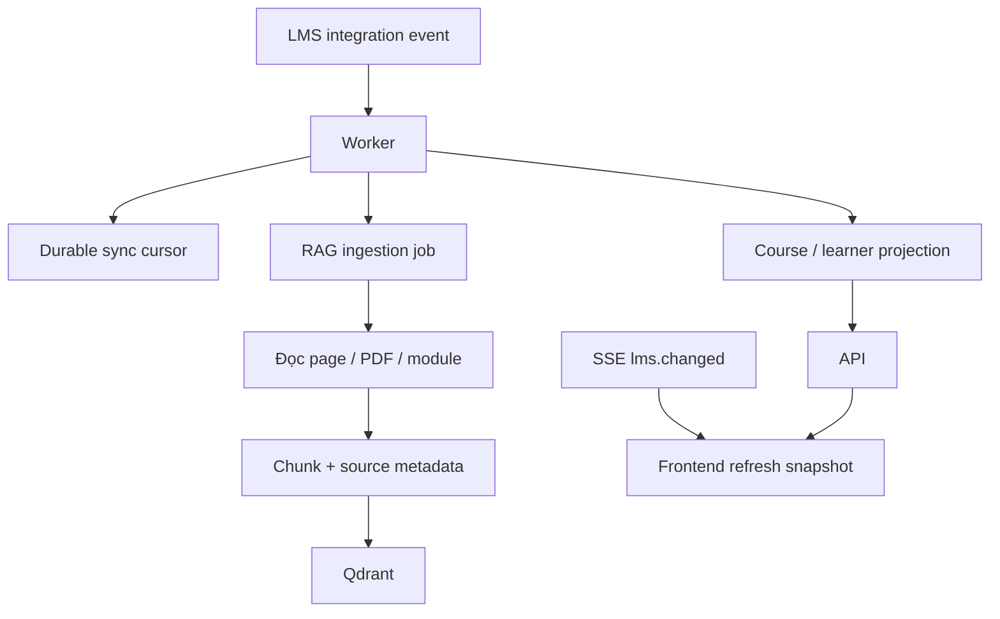

# PaceWise architecture and data flow

Tài liệu này mô tả kiến trúc đang chạy trong repository, không phải kiến trúc dự kiến. Mốc kiểm chứng: **04/10/2026**.

## 1. Component diagram

## 2. Agent graph

`LearningGraphState` mang theo assignment, module, lịch rảnh/bận, kế hoạch hiện tại, hồ sơ học tập, nguồn truy xuất, risk, phương án Recover và bản nháp Reflect. Runtime Docker dùng PostgreSQL checkpointer; unit test có thể dùng memory checkpointer.

## 3. Plan → Do → Reflect

## 4. Lưu lịch cá nhân sau reload

Workspace là nguồn dữ liệu chính cho lịch cá nhân, routine, plan, session và reflection. LMS vẫn là nguồn chính cho môn học, deadline, lịch lớp và submission. Bản `planDraft` chỉ là đề xuất AI và không được ghi đè lịch cá nhân mới hơn.

## 5. LMS sync và RAG

- Worker xử lý event theo cursor và hàng đợi bền vững, nên restart không làm mất vị trí đồng bộ.
- Chat không ingest tài liệu trong request; nó chỉ truy xuất corpus đã chuẩn bị.
- Nếu evidence không đạt ngưỡng, QA phải báo thiếu nguồn thay vì tạo citation giả.

## 6. Data ownership và bảo mật

| Dữ liệu | Nguồn chính | Quy tắc |
|---|---|---|
| Course, assignment, quiz, deadline, submission | LMS PostgreSQL/API | PaceWise đọc theo enrollment/session; không cho client tự chọn user/role |
| Lịch cá nhân, routine, plan, study session, reflection | PaceWise PostgreSQL | Lưu theo `user_id`; PUT yêu cầu CSRF và version để phát hiện conflict |
| Trạng thái hội thoại agent | LangGraph PostgreSQL checkpointer | Tách theo thread/session đã xác thực |
| Chunk học liệu và metadata nguồn | Qdrant | Chỉ ingest từ course context được phép |
| Tổng quan lớp | Projection tổng hợp | Instructor-only; ngưỡng nhóm tối thiểu, không dùng để xếp hạng/chấm điểm |
| Google token | PaceWise backend | Mã hóa server-side; không trả refresh token xuống browser |

Session dùng cookie `HttpOnly`; request thay đổi trạng thái cần CSRF. Service key giữa PaceWise và LMS không được đóng gói vào frontend.

## 7. Deployment map

| Service | Port host | Vai trò |
|---|---:|---|
| `frontend` | 5173 | Nginx phục vụ React và proxy `/api` |
| `backend` | 8000 | FastAPI, auth, workspace, LangGraph, calendar integration |
| `worker` | — | LMS projection và RAG ingestion |
| `lms-simulator` | 8010 | Canvas-compatible demo LMS |
| `pacewise-postgres` | 5433 | Workspace, session, memory, queue, checkpoint |
| `lms-postgres` | 5434 | Dữ liệu LMS demo |
| `qdrant` | 6333 | Vector store |
| `prometheus` | 9090 | Metrics, profile `observability` |
| `grafana` | 3001 | Dashboard, profile `observability` |

Các endpoint và lệnh chạy được ghi trong [README](../README.md). Kết quả kiểm chứng hiện tại nằm tại [evaluation-evidence.md](evaluation-evidence.md).
