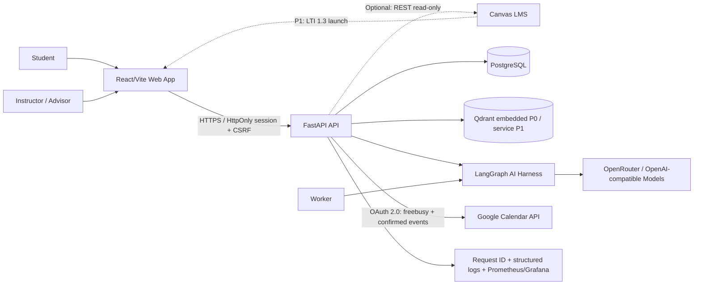
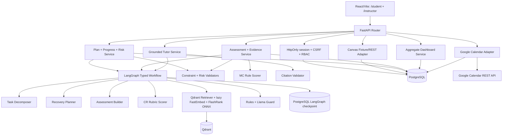
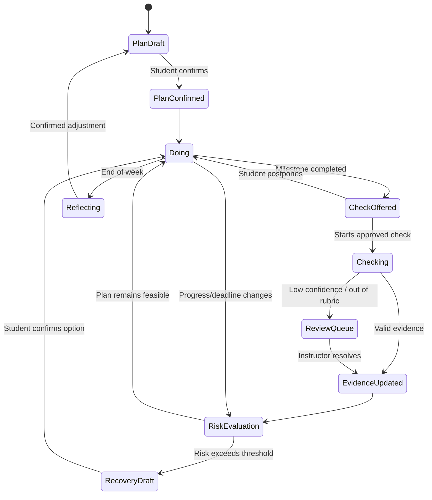
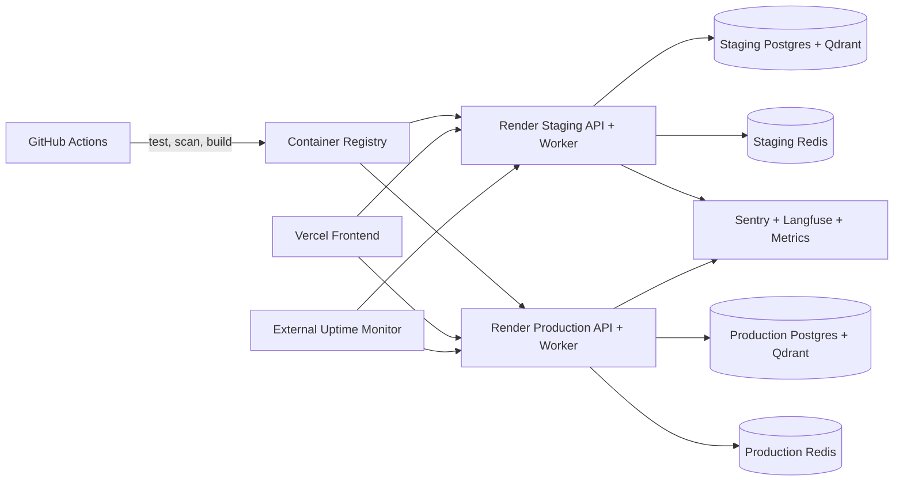

# PaceWise — Architecture

**Trạng thái:** Kiến trúc thực thi cho MVP + hướng mở rộng production pilot · **Cập nhật:** 28/09/2026

## 1. System context

Canvas là hệ thống bên ngoài. MVP luôn chạy bằng fixture; REST chỉ đọc chỉ bật khi có sandbox/token và LTI 1.3 là P1 khi có developer key. PaceWise không fork Canvas và không ghi điểm/nộp bài. Fixture dùng cùng schema nội bộ để CI/demo vẫn chạy khi sandbox không khả dụng.

## 2. Application components

Ranh giới quan trọng:

- LLM hiểu ngữ nghĩa và sinh đề xuất; code kiểm tra quyền, schema, deadline, key MC, citation existence và privacy threshold.
- Assessment builder không tự duyệt output của chính nó. Item/rubric phải qua quality gate và giảng viên xác nhận.
- Độ tin cậy thấp, câu trả lời ngoài rubric hoặc bộ chấm bất đồng được chuyển vào hàng chờ giảng viên; không tự cập nhật bằng chứng học tập.
- Mọi plan/re-plan, assessment publish và instructor action đều version hóa/audit.

## 3. Plan–Do–Reflect workflow

Trong sơ đồ trạng thái, `Check` và `Recovery` là các nhánh hỗ trợ bên trong bước
`Do`, không phải hai giai đoạn độc lập thay thế chu trình của đề bài.

## 4. Deployment and observability

Staging và production dùng project/schema, secret và telemetry environment tách biệt. Release gắn Git SHA, chạy Alembic migration, smoke test và có đường rollback image/migration tương thích.

## 5. Technology decisions

| Thành phần | Lựa chọn P0 | Lý do |
|---|---|---|
| Frontend | React 19 + TypeScript + Vite | Một codebase cho hai vai trò, production build phục vụ bằng Nginx |
| Backend | Python 3.11 + FastAPI + Pydantic + SQLAlchemy/Alembic | Khớp repo, API/schema rõ, migration được kiểm soát |
| Database/vector | PostgreSQL + Qdrant embedded P0 | PostgreSQL lưu nghiệp vụ/checkpoint; vector nằm trên volume demo, nâng thành Qdrant service khi scale |
| Cache/job | Chưa triển khai P0; Redis + worker là P1 | Chỉ thêm khi đo được bottleneck ingestion hoặc rate limit nhiều instance |
| AI | LangGraph + OpenAI-compatible client/OpenRouter | Workflow có state/HITL, đổi model qua config |
| RAG | FastEmbed đa ngôn ngữ + Qdrant + FlashRank ONNX | Pipeline ingest → retrieve → rerank → citation, lazy-load để giảm RAM |
| Guardrail | Quy tắc xác định trước + Llama Guard | Không phụ thuộc một prompt/classifier duy nhất |
| Canvas | Fixture bắt buộc; REST read-only có điều kiện; LTI 1.3 P1 | Demo tái lập, tích hợp thật khi có credential |
| Calendar | Google OAuth 2.0 + Calendar REST qua HTTPX | Scope tối thiểu, đọc busy/free và chỉ ghi study block sau HITL |
| Quality | Pytest, Vitest, Playwright, Locust/k6, RAGAS + metric xác định trước | Unit, integration, E2E, load và chất lượng AI |
| Observability | Request ID, structured logs, Prometheus/Grafana | Theo dõi lỗi/latency HTTP, agent node và RAG; OpenTelemetry/LLM tracing là P1 |

Hiện trạng P0 đã triển khai gồm request ID, structured logs, metrics Prometheus và dashboard
Grafana. OpenTelemetry/LLM tracing, Redis/RQ và Qdrant service tách riêng là bước nâng cấp cho
production; bản Docker hiện tại dùng Qdrant embedded trên volume để giảm RAM cho demo.

LangGraph dùng PostgreSQL checkpointer trong Docker/production. `MemorySaver` chỉ được giữ làm
fallback cho unit test hoặc cấu hình SQLite local. Embedding FastEmbed và FlashRank ONNX đều
lazy-load; chỉ workflow QA/RAG mới nạp model vào RAM.

## 6. Security and privacy boundaries

- Token Canvas, model key và DSN chỉ nằm trong secret store; không vào Git, prompt hoặc log.
- Google refresh token được mã hóa bằng Fernet trong PostgreSQL; access token và OAuth code không được lưu hoặc ghi log.
- Backend kiểm tra RBAC/tenant ở service layer; frontend ẩn nút không được xem là kiểm soát quyền.
- Log dùng mã giả, loại nội dung nhạy cảm; log vận hành giữ 30 ngày và dữ liệu pilot đã thay định danh giữ 90 ngày.
- Dashboard chỉ trả aggregate khi n≥5; chat/Reflect thô không hiển thị.
- Trạng thái bằng chứng không phải điểm chính thức; không xếp hạng hay tự động kỷ luật.
- Yêu cầu xóa hoàn tất trong 30 ngày; bản sao lưu hết hạn trong 30 ngày tiếp theo.
- Backup, restore, delete/export và incident runbook phải được kiểm thử trước pilot.
