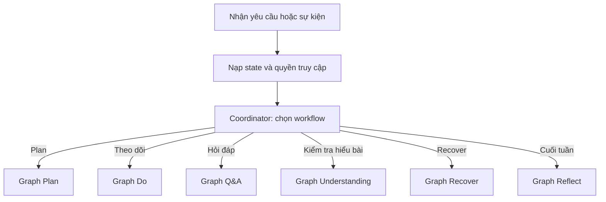
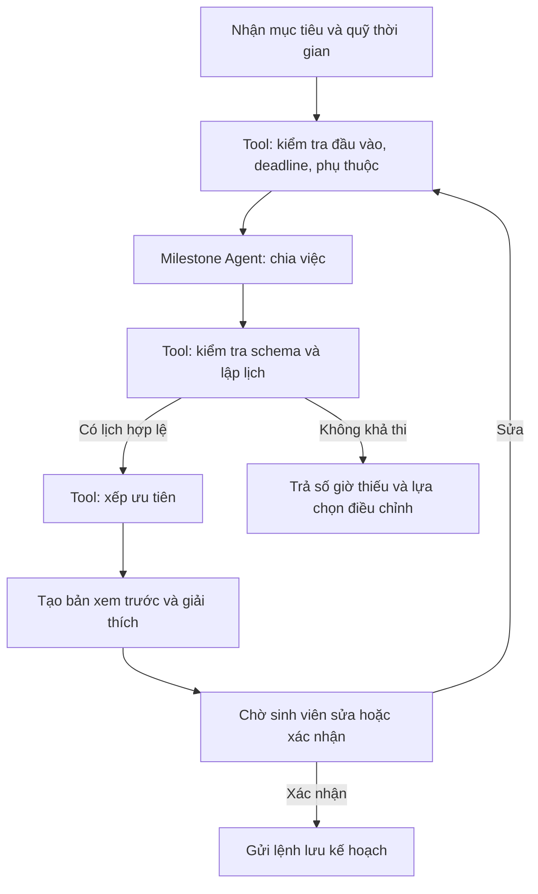
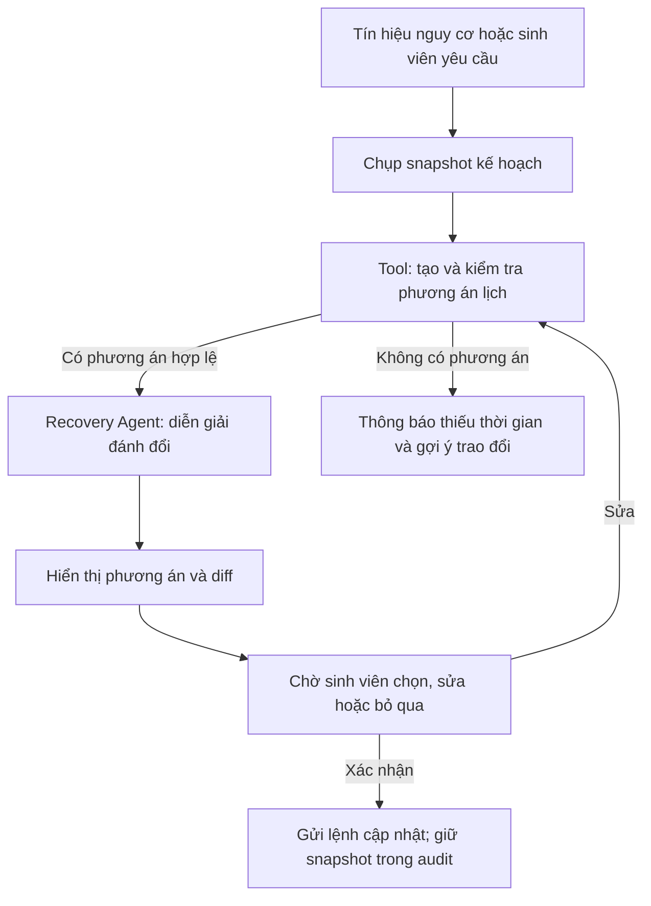

### 1. Graph tổng thể multi agent: 



### 2. A. Plan — lập kế hoạch tuần


B. Do — theo dõi tiến độ

Luồng này chủ yếu là phép tính, không cần thêm agent theo dõi riêng:

Nhận phiên học/thời gian thực tế → tool tính tiến độ, sai số, slack và phụ thuộc → tool kiểm tra ngưỡng → cập nhật state.

Nếu xuất hiện tín hiệu nguy cơ, Coordinator đưa ra lựa chọn mở Recover. Nếu sinh viên đánh dấu dữ liệu sai, state ghi disputed_evidence; số liệu đó không được dùng để đưa ra kết luận chắc chắn cho đến khi được xử lý.

C. Do — hỏi đáp có nguồn

Câu hỏi → kiểm tra an toàn và ý định làm hộ → Qdrant retriever → reranker → kiểm tra đủ nguồn → Study Support Agent → kiểm tra câu trả lời và trích dẫn → trả kết quả.

Study Support Agent có ba kiểu kết quả rõ ràng:

grounded_answer: trả lời kèm trích dẫn tới đúng tài liệu và đoạn;
guided_help: giải thích khái niệm, đặt câu hỏi gợi mở hoặc phản hồi bài làm thử khi liên quan bài tính điểm;
insufficient_sources: nêu phần chưa xác minh được và tài liệu cần xem.

Báo cáo trích dẫn sai tạo citation_feedback_event cho bộ đánh giá; agent không tự sửa tài liệu gốc.

D. Do — kiểm tra mức hiểu bài

Chọn đơn vị kiến thức → lấy câu hỏi và rubric được duyệt → sinh viên trả lời → tool chấm câu đóng / Understanding Agent phân tích câu mở → kiểm tra schema, bằng chứng và mâu thuẫn → tổng hợp trạng thái.

Understanding Agent trả nhận xét theo từng tiêu chí rubric, kèm đoạn trả lời của sinh viên làm bằng chứng. Node tổng hợp mới chọn một trong bốn trạng thái bạn đã định nghĩa. Nếu bằng chứng ít, mâu thuẫn hoặc ngoài rubric, trạng thái là chưa đủ bằng chứng và có thể tạo mục chờ giảng viên. Không tạo điểm số hay lệnh ghi gradebook. 

E. Recover 



Recovery Agent chỉ được diễn giải các phương án đã qua kiểm tra. Mỗi phương án mang kept_items, moved_items, hours_short_or_free, protected_deadlines và remaining_risks. Nếu không có nghiệm, graph không đi qua node cập nhật lịch.

F. Reflect — cuối tuần

Tool tổng hợp dữ liệu tuần → sinh viên trả lời tối đa ba câu → Reflection Agent tóm tắt và đề xuất một điều chỉnh → kiểm tra đề xuất → xem trước → sinh viên xác nhận → lưu điều chỉnh cho tuần sau.

Bản tóm tắt cần dẫn về dữ kiện, chẳng hạn “hai milestone mất lâu hơn dự kiến”, thay vì nhận định về tính cách hay năng lực. Điều chỉnh được lưu với effective_week là tuần sau.

4. State chung để các agent phối hợp

Bạn nên dùng một state có cấu trúc, thay vì chỉ truyền danh sách messages. Đây là bộ khung ở mức thiết kế:

```python
from typing import TypedDict, Annotated
import operator

class LearningGraphState(TypedDict):
    # --- 1. Định danh và định tuyến ---
    run_id: str
    student_id: str
    week_id: str
    workflow: str                  # plan | do | qa | understanding | recover | reflect
    current_node: str
    messages: Annotated[list[dict], operator.add] # QUAN TRỌNG: Lịch sử hội thoại
    request: dict

    # --- 2. Dữ liệu đầu vào (Context) ---
    goals: list[dict]
    assignments: list[dict]
    priority_weights: dict         # Bổ sung: Trọng số ưu tiên từ sinh viên
    availability: list[dict]
    unavailable_slots: list[dict]
    current_plan: dict | None
    learning_resources: list[dict]
    approved_rubric: dict | None

    # --- 3. Trạng thái trung gian & Đầu ra ---
    proposed_milestones: list[dict]
    candidate_schedules: list[dict]
    retrieved_passages: list[dict]
    
    # Bổ sung: Tách biệt kết quả chấm điểm
    assessment_result: dict | None 
    
    progress_metrics: dict
    risk_signals: Annotated[list[dict], operator.add] # Dùng add để dồn rủi ro theo thời gian
    recovery_snapshot: dict | None
    recovery_options: list[dict]
    reflection_draft: dict | None

    # --- 4. Cờ kiểm duyệt & Bất định (Guardrails & Uncertainty) ---
    security_flags: dict           # Bổ sung: Check injection, homework help
    validation_errors: Annotated[list[dict], operator.add]
    uncertainties: list[dict]
    disputed_evidence: list[dict]
    
    # --- 5. Trạng thái luồng điều khiển (Control Flow) ---
    status: str                    # running | awaiting_student | awaiting_teacher | completed | failed
    pending_action: dict | None
    student_decision: dict | None

    # --- 6. Truy vết (Tracing & Observability) ---
    source_refs: list[dict]
    audit_events: Annotated[list[dict], operator.add]
    output: dict | None 
```

Dưới đây là giải thích ngắn gọn, đi thẳng vào vai trò của từng thuộc tính trong LearningGraphState:

1. Định danh và định tuyến (Routing & ID)

run_id: ID duy nhất của một lần chạy (phiên/session).

student_id: Định danh của sinh viên.

week_id: Mã định danh của tuần học đang xử lý.

workflow: Luồng nghiệp vụ đang chạy (plan, qa, recover, v.v.).

current_node: Tên tác tử (agent) hoặc bước đang xử lý hiện tại.

messages: Lịch sử hội thoại (chat) giúp AI nhớ ngữ cảnh.

request: Yêu cầu/dữ liệu thô gửi lên từ frontend.

2. Dữ liệu đầu vào (Context)

goals: Mục tiêu học tập tuần này của sinh viên.

assignments: Danh sách bài tập, deadline lấy từ Canvas.

priority_weights: Trọng số ưu tiên (môn nào quan trọng hơn) do user thiết lập.

availability: Quỹ thời gian rảnh dự kiến mỗi ngày.

unavailable_slots: Các khung giờ bận không thể xếp lịch.

current_plan: Lịch trình hiện tại đang được áp dụng.

learning_resources: Tài liệu học liệu của môn học.

approved_rubric: Bareme/tiêu chí chấm điểm đã được giảng viên duyệt.

3. Trạng thái trung gian & Đầu ra (Agent Outputs)

proposed_milestones: Các task nhỏ được AI chia ra từ bài tập lớn.

candidate_schedules: Các phương án xếp lịch do bộ lập lịch tạo ra.

retrieved_passages: Các đoạn tài liệu RAG lấy ra từ vector DB (Qdrant).

assessment_result: Kết quả chấm điểm hiểu bài (đánh giá 4 mặt, độ tin cậy).

progress_metrics: Số liệu tiến độ thực tế (sai số thời gian, phần trăm hoàn thành).

risk_signals: Các cảnh báo nguy cơ (sắp trễ deadline, task lố giờ).

recovery_snapshot: Bản lưu tạm (backup) của lịch cũ trước khi tính lại lịch mới.

recovery_options: Các phương án lịch thay thế (kèm trade-offs) để sinh viên chọn.

reflection_draft: Bản tóm tắt nhận xét cuối tuần do AI viết nháp.

4. Cờ kiểm duyệt & Bất định (Guardrails)

security_flags: Cờ báo vi phạm quy tắc (hỏi bài hộ, prompt injection).

validation_errors: Lỗi khi check schema, thiếu phụ thuộc hoặc vượt thời gian.

uncertainties: Các phần AI không chắc chắn, cần highlight để người dùng xác nhận.

disputed_evidence: Các trích dẫn/dữ liệu bị sinh viên đánh dấu là sai.

5. Trạng thái luồng điều khiển (Control Flow)

status: Trạng thái của Graph (running, awaiting_student, awaiting_teacher...).

pending_action: Hành động đang chờ xử lý tiếp theo (ví dụ: chờ sinh viên duyệt lịch).

student_decision: Lựa chọn/xác nhận của sinh viên (để AI tiếp tục chạy).

6. Truy vết (Tracing & Logs)

source_refs: Danh sách nguồn tài liệu đã dùng (citations) để minh bạch thông tin.

audit_events: Nhật ký lưu lại mọi thay đổi (dùng cho audit log).

output: Kết quả dữ liệu cuối cùng được gói lại để trả về cho Frontend.