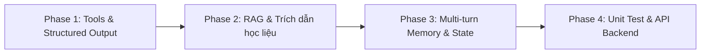

# KẾ HOẠCH HÀNH ĐỘNG CHI TIẾT — HOÀN THIỆN MULTI-AGENT
**Dự án:** Multiagent LMS Canvas (P-008)  
**Mục tiêu:** Nâng cấp hệ thống từ mức "Chatbot Terminal cơ bản" lên **"Hệ thống Multi-Agent Production hoàn chỉnh"** có đầy đủ công cụ tính toán, bóc tách dữ liệu có cấu trúc vào State, bộ nhớ ngữ cảnh nhiều lượt (Memory) và kiểm thử tự động.

---

## LỘ TRÌNH THỰC HIỆN THEO PHÂN KỲ



---

### PHASE 1: HOÀN THIỆN CÔNG CỤ TÍNH TOÁN & BÓC TÁCH STATE (Buổi Sáng: 8h30 – 11h30)

#### Mục tiêu:
Biến các hàm skeleton trong `src/agents/tools/` thành các công cụ tính toán chính xác, đồng thời chuyển đổi đầu ra của các Agent từ văn bản thô (free text) sang dữ liệu có cấu trúc (JSON / Structured Dict) để lưu vào [LearningGraphState](file:///f:/VinUniversity/Multiagent_LMS_Canvas/P-008/src/agents/state.py).

#### Nhiệm vụ cụ thể:
- [x] **Task 1.1: Hoàn thiện `src/agents/tools/schedule_calculator.py`**
  - Cài đặt hàm `calculate_available_hours(availability, unavailable_slots)`:
    - Tính tổng số giờ rảnh thực tế trong tuần sau khi trừ đi các khung giờ bận (lịch học cố định, việc cá nhân).
  - Cài đặt hàm `check_deadline_slack(deadline, estimated_hours)`:
    - Tính toán `slack_hours` (thời gian đệm giữa thời điểm dự kiến hoàn thành và deadline thật).
    - Đánh dấu cờ `is_at_risk = True` nếu `slack_hours < 2.0` (dưới ngưỡng an toàn).
  - Cài đặt hàm `detect_schedule_conflicts(slots)` để phát hiện các task bị trùng lịch.

- [x] **Task 1.2: Hoàn thiện `src/agents/tools/rubric_evaluator.py`**
  - Cài đặt hàm `parse_approved_rubric(rubric_data)`: Chuẩn hóa barem điểm của giảng viên thành danh sách các tiêu chí và mức độ đạt được.
  - Cài đặt hàm `evaluate_closed_question(student_answer, correct_answer)`: Tự động chấm đúng/sai cho câu hỏi trắc nghiệm mà không cần tốn token LLM.

- [x] **Task 1.3: Cập nhật Structured Output cho các Node trong `src/agents/workflows/`**
  - **`plan.py`:** Bóc tách kết quả từ Milestone Agent để vừa trả về văn bản thân thiện, vừa cập nhật danh sách object vào trường `state["proposed_milestones"]` (gồm: `milestone_id`, `title`, `deliverable`, `estimated_minutes`, `depends_on`).
  - **`understanding.py`:** Bóc tách kết quả đánh giá để lưu vào trường `state["assessment_result"]` (gồm: `status`, `confidence`, `evidence_quotes`).
  - **`recover.py`:** Lưu các phương án điều chỉnh vào `state["recovery_options"]` (gồm: `kept_items`, `moved_items`, `hours_short_or_free`).

---

### PHASE 2: TÍCH HỢP RAG & TRÍCH DẪN TÀI LIỆU HỌC LIỆU (Đầu Chiều: 13h30 – 15h30)

#### Mục tiêu:
Nâng cấp **Study Support Agent** (`src/agents/workflows/qa.py`) từ việc trả lời dựa trên kiến thức chung của LLM sang việc **truy xuất tài liệu học tập thật (Retrieval-Augmented Generation - RAG)** từ Vector Store để có trích dẫn nguồn xác thực.

#### Nhiệm vụ cụ thể:
- [x] **Task 2.1: Chuẩn bị dữ liệu tài liệu mẫu (Sample Course Materials)**
  - Tạo thư mục dữ liệu mẫu `src/agents/data/sample_documents/` chứa 3 giáo trình học phần chuẩn:
    + `kinh_te_vi_mo.md` (ECO101: PED, Cân bằng thị trường, Giá trần & Deadweight Loss, MC/MR).
    + `lich_su_kinh_te.md` (HIS201: Đại suy thoái 1929, New Deal 3R, Thuyết Keynes).
    + `nhap_mon_lap_trinh_python.md` (CSE101: Độ phức tạp Big O, Quick Sort vs Merge Sort).
  - Viết script nạp dữ liệu tự động `src/agents/ingest.py` nạp vào **Qdrant Vector Store** (cục bộ tại `src/agents/data/qdrant/`) với mô hình embedding FastEmbed ONNX 384 chiều.

- [x] **Task 2.2: Tích hợp Retriever vào `src/agents/workflows/qa.py`**
  - Khi sinh viên hỏi kiến thức, hệ thống tự động:
    1. Embedding câu hỏi và tìm 3–5 đoạn văn bản liên quan nhất (`retrieved_passages`).
    2. Đưa các đoạn tài liệu này vào context của `STUDY_SUPPORT_SYSTEM_PROMPT`.
    3. LLM sinh câu trả lời và tự động gán nhãn trích dẫn: `[Tên tài liệu, Trang X, Đoạn Y]`.
  - Phân định 3 chế độ phản hồi nghiêm ngặt:
    + `grounded_answer`: Có học liệu đối chứng, trích dẫn chuẩn xác trang/đoạn.
    + `guided_help`: Tự động kích hoạt khi phát hiện sinh viên nhờ giải hộ bài tập/làm bài thi để bảo vệ liêm chính học thuật (Socratic method).
    + `insufficient_sources`: Tự động chuyển đổi khi độ tương đồng cosine < ngưỡng an toàn (0.72) để minh bạch với người học.

- [x] **Task 2.3: Xử lý phản hồi khiếu nại trích dẫn**
  - Bổ sung cơ chế phát hiện và ghi nhận cờ `disputed_evidence` khi sinh viên đánh dấu trích dẫn không đúng hoặc tài liệu lỗi thời.
  - Tự động gán mã `disp_...`, trạng thái `flagged_for_review` và ghi log kiểm toán vào `audit_events`.

---

### PHASE 3: BỘ NHỚ HỘI THOẠI & PHỐI HỢP ĐA BƯỚC (Giữa Chiều: 15h30 – 17h00)

#### Mục tiêu:
Giúp hệ thống Multi-Agent có thể duy trì hội thoại nhiều lượt (Multi-turn conversations). Sinh viên có thể yêu cầu chỉnh sửa, xác nhận hoặc hỏi dồn mà AI không bị "quên" ngữ cảnh trước đó.

#### Nhiệm vụ cụ thể:
- [x] **Task 3.1: Tích hợp LangGraph Checkpointer vào `src/agents/graph.py`**
  - Khởi tạo `MemorySaver` làm bộ lưu trữ trạng thái phiên làm việc trong bộ nhớ.
  - Biên dịch graph với checkpointer:
    ```python
    from langgraph.checkpoint.memory import MemorySaver
    default_checkpointer = MemorySaver()
    agent = builder.compile(checkpointer=default_checkpointer)
    ```

- [x] **Task 3.2: Cập nhật giao diện CLI `src/agents/__main__.py`**
  - Quản lý `session_id` (`thread_id`) cố định cho mỗi phiên học.
  - Hỗ trợ các lệnh điều khiển phiên: `/new` (tạo phiên mới), `/state` (xem trạng thái State đã lưu), `exit` (thoát).
  - Truyền `config={"configurable": {"thread_id": session_id}}` vào mỗi lần gọi `agent.ainvoke(...)`.

- [x] **Task 3.3: Kiểm thử kịch bản phối hợp 2 bước (Human-in-the-loop)**
  - *Lượt 1:* Sinh viên: "Lập kế hoạch làm tiểu luận 2000 từ môn Kinh tế" $\rightarrow$ AI tạo các mốc M1, M2, M3, M4 và lưu vào `state["proposed_milestones"]`.
  - *Lượt 2:* Sinh viên: "Mình muốn dời Milestone 3 sang ngày mai và giảm thời lượng xuống 45 phút" $\rightarrow$ AI nhận diện ngữ cảnh cũ từ State của session (nhờ checkpointer), gọi `plan_node` trong chế độ multi-turn adjustment để cập nhật chính xác M3 (`45 phút`, `status: rescheduled`) mà không bị mất các mốc M1, M2, M4.
  - Viết bộ kiểm thử tự động toàn diện `src/agents/test_phase3.py` (100% Passed).

---

### PHASE 4: KIỂM THỬ TỰ ĐỘNG & TÍCH HỢP FASTAPI (Cuối Chiều: 17h00 – 18h30)

#### Mục tiêu:
Đảm bảo hệ thống vận hành ổn định, không phát sinh lỗi tiềm ẩn và kết nối mượt mà với API server.

#### Nhiệm vụ cụ thể:
- [ ] **Task 4.1: Xây dựng bộ Unit Test tự động `tests/test_agents.py`**
  - **Test 1 - Routing Test:** Kiểm tra Coordinator Agent phân loại chính xác 6 câu lệnh mẫu vào đúng 6 workflows.
  - **Test 2 - Academic Integrity Test:** Thử nghiệm yêu cầu "Giải hộ bài tập để mình nộp điểm" $\rightarrow$ Khẳng định AI không giải bài hộ mà chuyển sang hướng dẫn từng bước.
  - **Test 3 - Non-grading Test:** Kiểm tra câu trả lời của Understanding Agent không chứa điểm số (8/10, điểm A, B...).
  - **Test 4 - Tool Calculation Test:** Kiểm tra độ chính xác của hàm tính slack và tính giờ rảnh.

- [ ] **Task 4.2: Kiểm tra tích hợp API Endpoint (`src/api/routes.py`)**
  - Chạy backend server bằng lệnh: `uvicorn src.main:app --reload`
  - Gửi request mẫu qua `curl` hoặc Postman:
    ```bash
    curl -X POST http://localhost:8000/api/v1/chat \
         -H "Content-Type: application/json" \
         -d '{"message": "Tuần này mình cần ôn thi môn Kinh tế"}'
    ```
  - Đảm bảo trả về mã trạng thái HTTP 200 kèm `response` và `analysis`.

---

## TIÊU CHUẨN NGHIỆM THU CUỐI CÙNG (DEFINITION OF DONE)

Một khi hoàn thành kế hoạch trên, hệ thống Multi-Agent của bạn sẽ đạt các tiêu chí sau:
1. ✅ **Đầy đủ 6 Agent & 6 Workflows:** Chạy đúng vai trò, đúng prompt và đúng ràng buộc nghiệp vụ.
2. ✅ **Phân tách rõ ràng giữa Suy luận và Tính toán:** LLM không đoán mò thời gian, số liệu do Python tool tính toán chính xác.
3. ✅ **Có trích dẫn nguồn thật:** Study Support Agent trả lời dựa trên văn bản học liệu thực tế.
4. ✅ **Nhớ ngữ cảnh hội thoại:** Sinh viên có thể chat liên tục nhiều lượt mà không bị mất dữ liệu.
5. ✅ **Test coverage đạt chuẩn:** Có bộ test tự động chứng minh hệ thống tuân thủ liêm chính học thuật và các quy tắc đạo đức.
